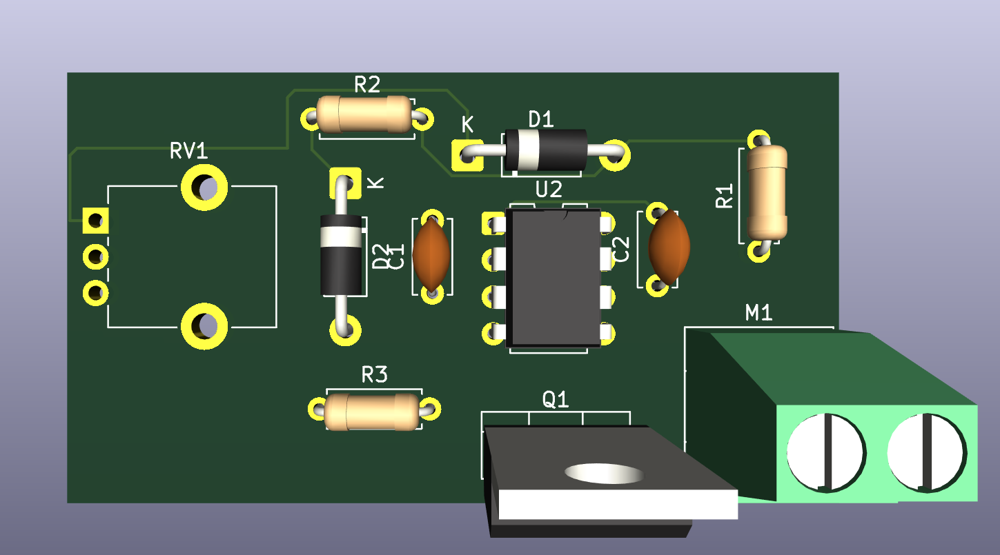
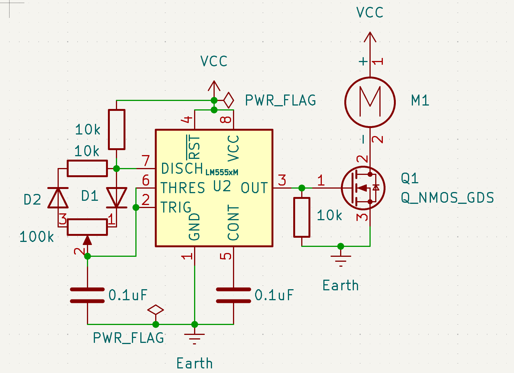

# Tinkeringlab

Tinkeringlab is a compact KiCad-based PCB project designed for electronics experimentation, circuit testing, and rapid prototyping. The board combines a power-control section with a MOSFET driver stage and a delay/monitor circuit for switching or protection logic.

## Project contents

This directory contains the main hardware design files:

- `Tinkeringlab.kicad_pro` — KiCad project configuration
- `Tinkeringlab.kicad_sch` — schematic design
- `Tinkeringlab.kicad_pcb` — PCB layout
- `docs/pcb-top-view.png` — top-view PCB render
- `docs/control-circuit.png` — control schematic overview

## Board overview

The design appears to implement a small power-control module with:

- a load switch / MOSFET output stage
- a timing or reset delay network using a 555-based circuit
- transient protection and pull-down / biasing components
- an indicator or power-flag monitoring circuit
- connector pads for interfacing with an external load or actuator

## PCB render

## Control circuit

## Intended use

This board is intended for experimentation and learning, including:

- testing power switching behavior
- evaluating MOSFET-based load control
- exploring timing circuits driven by a 555-style IC
- prototyping small custom control electronics

## Getting started

1. Install KiCad 8 or newer.
2. Open `Tinkeringlab.kicad_pro` in KiCad.
3. Review the schematic and PCB layout carefully before fabrication.
4. Run a DRC check and verify all nets, footprints, and clearances.
5. Export Gerber and drill files only after confirming the design is correct.

## Recommended checks before manufacturing

- verify component values and pin assignments
- confirm the MOSFET orientation and power path
- check the 555 timer and decoupling capacitor placement
- validate the PCB trace widths for the expected current
- review the connector orientation and mechanical fit

## Notes

This is a prototype hardware project and should be validated through design review and bench testing before production use. Always confirm voltage ratings, current limits, thermal behavior, and layout constraints before building or ordering boards.
